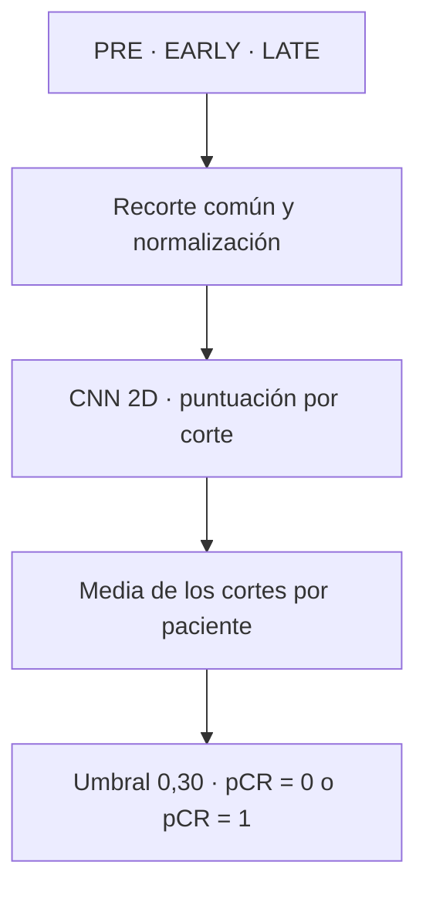

# 🩻 Predicción de respuesta al tratamiento
### Cáncer de mama · Imágenes DCE-MRI · Aprendizaje Automático

**Claudia Lozano Pérez · Grado en Ingeniería Matemática**

Una CNN propia para estudiar si las imágenes de resonancia magnética permiten anticipar la **respuesta patológica completa al tratamiento (pCR)**.

---

> [!IMPORTANT]
> **Proyecto académico y de investigación.** La CNN obtuvo un AUC de **0,518** en el test independiente, con capacidad de discriminación limitada. Sus resultados no deben utilizarse para tomar decisiones clínicas.

## De un vistazo

| 🧑‍🤝‍🧑 Datos | 🩻 Entrada | 🎯 Evaluación | 📊 Resultado principal |
|:---:|:---:|:---:|:---:|
| **1.097** pacientes de desarrollo | **PRE · EARLY · LATE** | **176** pacientes de test | **AUC 0,518** |
| Entrenamiento + validación | Tres fases del mismo corte | Media de puntuaciones por paciente | IC del 95 %: **0,430–0,607** |

**Explorar:** [Objetivo](#objetivo) · [Datos](#datos) · [Modelo](#modelo) · [Resultados](#resultados) · [Datos clínicos](#datos-clinicos) · [Aplicación](#aplicacion) · [Código](#codigo) · [Límites](#limites)

## 01 · ¿Qué queremos predecir?

El proyecto estudia la **respuesta al tratamiento**. La salida distingue entre estas dos clases:

| Clase | Significado |
|---|---|
| **pCR = 1** | Se alcanza respuesta patológica completa tras el tratamiento. |
| **pCR = 0** | No se alcanza respuesta patológica completa. |

La CNN genera una puntuación por corte. Después se calcula la **media de los cortes de una paciente** y se aplica el umbral fijado en validación.

| Puntuación media | Predicción |
|---|---|
| **Menor que 0,30** | pCR = 0 |
| **Mayor o igual que 0,30** | pCR = 1 |

> **Ejemplo:** una puntuación del **3,89 %** está por debajo del umbral del **30 %**, por lo que corresponde a **pCR = 0**. La puntuación no representa la cantidad de cáncer ni una probabilidad clínica calibrada.

## 02 · Datos y separación por pacientes

Se utilizaron imágenes de **BreastDCEDL**, procedentes de **I-SPY1, I-SPY2 y Duke**. Cada entrada contiene las fases PRE, EARLY y LATE del mismo corte.

| Conjunto | Pacientes | Cortes tras el preprocesado | Función |
|---|---:|---:|---|
| Entrenamiento | 878 | 8.755 | Aprender los parámetros. |
| Validación | 219 | 2.190 | Seleccionar el checkpoint y fijar decisiones. |
| Test independiente | 176 | 1.758 | Evaluar el modelo seleccionado. |

**La partición se realiza por paciente:** los cortes de una misma paciente no se reparten entre estos conjuntos.

| Distribución de clases | pCR = 0 | pCR = 1 |
|---|---:|---:|
| Desarrollo: entrenamiento + validación | 775 | 322 |
| Test | 123 | 53 |

En ambos conjuntos, aproximadamente **3 de cada 10 pacientes** alcanzan pCR = 1. Este desbalance hace necesario interpretar varias métricas, además del porcentaje de aciertos.

## 03 · Del corte a la predicción

| Elemento | Modelo final |
|---|---|
| Experimento | `cnn5_5pool_otsu_spatial_f1` |
| Arquitectura | CNN propia desde cero; cinco bloques convolucionales con ReLU y atención espacial. |
| Entrada | Tres canales: **PRE, EARLY y LATE**, de 256 × 256 píxeles. |
| Preparación | Región de primer plano mediante Otsu, recorte común, ajuste de tamaño conservando la proporción y normalización común. |
| Entrenamiento | AdamW y pérdida binaria ponderada. |
| Checkpoint seleccionado | Época **12**, según el AUC de validación por paciente. |
| Agregación | Media de las puntuaciones de los cortes. |

Los canales del modelo final son las **tres fases originales preprocesadas**; no se construyen explícitamente como restas entre fases. Los volteos, rotaciones y desplazamientos se aplican conjuntamente a las fases **solo durante el entrenamiento**.

## 04 · ¿Qué resultados obtuvimos?

### Capacidad de discriminación

| Evaluación del checkpoint original | AUC ROC |
|---|---:|
| Entrenamiento | 0,769 |
| Validación | 0,556 |
| **Test independiente** | **0,518** |

El AUC indica la capacidad de ordenar a las pacientes según su respuesta: **0,5** es la referencia de una ordenación al azar y **1** representa una separación perfecta.

El intervalo bootstrap del 95 % del AUC de test fue **[0,430; 0,607]**, obtenido con **5.000 remuestreos por paciente**. El intervalo incluye 0,5 y no permite concluir que el modelo discrimine por encima del azar en la población de origen.

En experimentos adicionales de **validación cruzada con cinco folds**, el AUC medio de validación fue **0,566 ± 0,014** —media y desviación estándar entre los cinco checkpoints—. Esta cifra no es un intervalo de confianza ni sustituye al test del modelo original.

### Matriz de confusión · test con umbral 0,30

| Resultado real ↓ / Predicción → | **pCR = 0** | **pCR = 1** |
|---|---:|---:|
| **pCR = 0** | **61** · verdaderos negativos | **62** · falsos positivos |
| **pCR = 1** | **29** · falsos negativos | **24** · verdaderos positivos |

| Métrica | Resultado |
|---|---:|
| Accuracy | 48,3 % |
| Exactitud balanceada | 47,4 % |
| Precisión de pCR = 1 | 27,9 % |
| Recall de pCR = 1 | 45,3 % |
| F1-score de pCR = 1 | 0,345 |
| F1-score de pCR = 0 | 0,573 |
| F1-score macro | 0,459 |

**Lectura práctica:** la CNN identificó **24 de las 53** pacientes que alcanzaron pCR = 1. De las **86** que clasificó como pCR = 1, **24** pertenecían realmente a esa clase.

<strong>¿Por qué no basta con mirar la accuracy?</strong>

Predecir siempre pCR = 0 habría acertado **123 de 176 pacientes: un 69,9 %**, pero no habría identificado ninguna de las pacientes con pCR = 1.

Por eso se incluyen recall, precisión, F1-score y exactitud balanceada. Con el umbral fijado, la CNN tampoco superó el **50 % de exactitud balanceada** de esa referencia.

## 05 · ¿Añadir datos clínicos mejoró el resultado?

Se comparó un clasificador exclusivamente clínico con otro que combinaba los datos clínicos y la media de **128 características de la CNN congelada**.

| Variables | AUC solo clínica | AUC CNN + clínica |
|---|---:|---:|
| HR + HER2 | 0,646 | 0,598 |
| HR + HER2 + edad | 0,697 | 0,612 |
| HR + HER2 + edad + volumen tumoral | **0,715** | **0,613** |

> **En las mismas 219 pacientes de validación, añadir las características de esta CNN no mejoró el resultado del modelo clínico.**

La combinación con volumen obtuvo un AUC de **0,871 en entrenamiento** y **0,613 en validación**. La mejora observada al entrenar no se mantuvo en pacientes distintas.

Esta comparación es **exploratoria y posterior al test del modelo de imagen**. Sus cifras corresponden a validación y no deben interpretarse como resultados de test independiente. La comparabilidad del volumen tumoral entre cohortes requiere revisión.

## 06 · ¿Qué aprendimos al revisar las predicciones?

Los análisis posteriores utilizaron las **predicciones de test guardadas**, sin volver a entrenar la CNN ni modificar el umbral.

<strong>Resultados por cohorte</strong>

| Cohorte | Pacientes | pCR = 0 | pCR = 1 | AUC |
|---|---:|---:|---:|---:|
| Duke | 42 | 33 | 9 | 0,727 |
| I-SPY1 | 35 | 23 | 12 | 0,344 |
| I-SPY2 | 99 | 67 | 32 | 0,483 |

El rendimiento observado fue distinto entre grupos. Hay pocas pacientes en algunos subgrupos, especialmente positivas, por lo que las cifras son inciertas. Las diferencias no demuestran por sí solas una causa ni garantizan que se repitan con otras pacientes.

<strong>Calibración de las puntuaciones</strong>

El **Brier score global fue 0,247**. Resume el error de las puntuaciones respecto a las etiquetas, pero no mide exclusivamente la calibración.

Los intervalos de puntuación más altos contenían pocas pacientes. Las salidas no se han validado como probabilidades clínicas fiables. Evaluar la calibración no equivale a ajustar un calibrador.

<strong>Revisión visual y control de calidad</strong>

Se revisaron falsos positivos y falsos negativos comparando PRE, EARLY y LATE originales con sus entradas preprocesadas. Esta inspección permite formular hipótesis sobre recorte, intensidades y correspondencia entre fases; no demuestra automáticamente la causa de cada error.

Las pacientes **ISPY1_1148 e ISPY1_1193 se conservaron en la validación original de 219 pacientes del modelo final**. Se probaron exclusiones en otros experimentos, identificados por separado. Sus imágenes de aspecto atípico requieren revisión adicional: una diferencia de brillo no basta para declarar una imagen incorrecta.

## 07 · Probar la aplicación

### [→ Abrir la aplicación en GitHub Pages](https://claudiaalozano.github.io/caso01_cancer/)

1. **Selecciona un ejemplo** o carga PRE, EARLY y LATE de la misma paciente y del mismo corte.
2. Pulsa **Conectar CNN** para preparar la inferencia y ejecutar las comprobaciones técnicas.
3. **Analiza los cortes** y consulta la media por paciente.
4. Opcionalmente, introduce los datos clínicos y pulsa **Calcular CNN + datos**.

| Requisito de las imágenes | Valor |
|---|---|
| Formato | PNG en escala de grises de 8 bits. |
| Tamaño | 256 × 256 píxeles. |
| Peso máximo | 2 MB por archivo. |
| Correspondencia | Misma paciente y mismo corte en las tres fases. |

Si se aportan solo algunos cortes, la aplicación calcula la media únicamente con ellos. Ese resultado puede diferir de la evaluación completa de la paciente.

**Las seis referencias de Python son comprobaciones de equivalencia técnica.** El modelo es completo y no está limitado a seis pacientes. Estas comprobaciones no acreditan utilidad clínica.

### ¿Dónde está cada parte?

| Servicio | Función |
|---|---|
| **GitHub Pages** | Publica la interfaz y sirve los recursos de la aplicación. |
| **Release de GitHub** | Distribuye el ONNX que se incorpora al sitio durante el despliegue. |
| **Hugging Face** | Aloja una copia del modelo y su documentación; la web no descarga el modelo desde aquí. |
| **ONNX Runtime Web** | Ejecuta la CNN en el navegador. |

La comparación clínica requiere también los archivos originales `clasificador_combinado.json` y `cnn_pcr_features.onnx`, coherentes con el experimento exportado.

## 08 · Organización del código

| Ubicación | Contenido |
|---|---|
| [`app/`](app/) | Interfaz, scripts, ejemplos y recursos de inferencia. |
| [`src/`](src/) | Preprocesado, entrenamiento, evaluación y análisis en Python. |
| [`src/archivos_app/`](src/archivos_app/) | Gráficas de folds, bootstrap del AUC, análisis del test y revisión de errores. |
| `resultados/` | Historiales, métricas y figuras generadas en los experimentos. |
| [`.github/workflows/pages.yml`](.github/workflows/pages.yml) | Despliegue de GitHub Pages. |

<strong>Scripts principales y dependencias internas</strong>

| Archivo | Función |
|---|---|
| [`descarga_datos.py`](src/descarga_datos.py) | Descarga de los datos. |
| [`preprocessing.py`](src/preprocessing.py) | Preparación de las imágenes. |
| [`model3.py`](src/model3.py) | Arquitectura y entrenamiento de la CNN. |
| [`evaluar_guardado.py`](src/evaluar_guardado.py) | Evaluación de los pesos guardados. |
| [`distribucion_probabilidades.py`](src/distribucion_probabilidades.py) | Visualización de puntuaciones; lo importan el entrenamiento y la evaluación. |
| [`modelo_combinado.py`](src/modelo_combinado.py) | Comparación exploratoria con datos clínicos. |
| [`exportar_onnx.py`](src/exportar_onnx.py) | Exportación a ONNX. |
| [`verificar_onnx_imagenes.py`](src/verificar_onnx_imagenes.py) | Comprobación de equivalencia con ejemplos de imágenes. |

Los scripts adicionales conservan las comparaciones de experimentos, la exploración de variables y las auditorías de calidad.

Algunos datos, pesos y resultados pueden mantenerse fuera del repositorio de código. La organización descrita no implica que todos los recursos estén distribuidos públicamente.

## 09 · Conclusiones y próximos pasos

| Lo observado | Lo que implica |
|---|---|
| **AUC de test cercano a 0,5** | La CNN mostró una capacidad de discriminación limitada. |
| **Diferencia entre entrenamiento y validación** | Parte del aprendizaje no se trasladó a pacientes distintas. |
| **La clínica sola superó a la combinación en validación** | Añadir características de esta CNN no aportó una mejora en esa comparación. |
| **Resultados diferentes por cohorte** | Se necesitan muestras mayores y análisis de las diferencias entre grupos. |
| **Puntuaciones sin calibración clínica validada** | No deben comunicarse como probabilidades individuales fiables. |

Queda por profundizar en la revisión de errores, la comparabilidad de las variables clínicas y la evaluación en nuevas pacientes. La CNN trabaja con cortes **2D**, sin representar directamente las relaciones espaciales del volumen completo.

La selección entre múltiples experimentos sobre una misma validación puede producir estimaciones optimistas. Los análisis realizados después del test se presentan como **exploratorios**.

---

**Claudia Lozano Pérez**  
Grado en Ingeniería Matemática · Aprendizaje Automático

[Web](https://claudiaalozano.github.io/caso01_cancer/) · [Release del modelo](https://github.com/claudiaalozano/caso01_cancer/releases/tag/modelo-v1) · [Hugging Face](https://huggingface.co/claudiaalozano/caso01_cancer)

La disponibilidad pública del código no implica permiso para redistribuir los datos de origen. Deben respetarse las condiciones de uso de sus fuentes.
